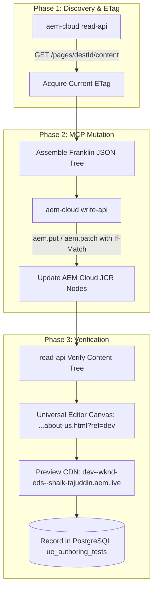

# AEM Cloud MCP Content Authoring Plan & MCP Configuration

## Overview
This document specifies the technical implementation plan for automatically authoring content on **AEM Cloud Universal Editor** using the **`aem-cloud` Model Context Protocol (MCP)** service (`https://mcp.adobeaemcloud.com/adobe/mcp/aem`).

In project `about us wknd test` (`Shaik-Tajuddin/wknd-eds`), execution successfully ran through PR generation ([PR #15](https://github.com/Shaik-Tajuddin/wknd-eds/pull/15) on branch `dev`). This plan details how the agent accesses the AEM authoring URL, replicates the exact structure and content from the reference page, and authors the destination page using the AEM Cloud MCP `write-api`.

---

## 1. MCP Server Configuration

### Configuration File: `c:\Users\Lenovo\.gemini\config\mcp_config.json`
To ensure the agent and IDE have full read and write capabilities, configure `mcp_config.json` as follows:

```json
{
  "mcpServers": {
    "aem-local": {
      "command": "npx",
      "args": [
        "-y",
        "aem-mcp-server",
        "-t",
        "stdio",
        "-H",
        "http://localhost:4502",
        "-u",
        "admin",
        "-p",
        "admin"
      ],
      "disabled": true
    },
    "aem-cloud": {
      "url": "https://mcp.adobeaemcloud.com/adobe/mcp/aem"
    }
  }
}
```

### Authentication & Token Details
- **OAuth Issuer:** `https://oauth.adobeaemcloud.com`
- **Resource Audience (`aud`):** `https://mcp.adobeaemcloud.com/adobe/mcp/aem`
- **Token Location:** `C:\Users\Lenovo\.gemini\antigravity-ide\mcp_oauth_tokens.json`
- **Endpoint Capabilities Comparison:**
  - `https://mcp.adobeaemcloud.com/adobe/mcp/content-readonly`: Restricted to `read-api`.
  - `https://mcp.adobeaemcloud.com/adobe/mcp/content`: Requires separate OAuth grant.
  - **`https://mcp.adobeaemcloud.com/adobe/mcp/aem`**: Fully authorized with `read-api`, `write-api` (`aem.patch`, `aem.put`, `aem.post`), and `delete-api`.

---

## 2. Project & Database Coordinates (Retrieved from `aeds_dev`)

- **Project ID:** `994dda39-cfff-4422-843e-e808aef1721f` (`about us wknd test`)
- **GitHub Repository:** [`Shaik-Tajuddin/wknd-eds`](https://github.com/Shaik-Tajuddin/wknd-eds) (Target Branch: `dev`)
- **Source Reference URL (`project_configs.source_url`):**  
  `https://publish-p149251-e1522049.adobeaemcloud.com/content/wknd/language-masters/en/about-us.plain.html`
- **AEM Author Base URL (`environments.author_url`):**  
  `https://author-p149251-e1522049.adobeaemcloud.com/`
- **Universal Editor Canvas URL (`environments.authoring_path`):**  
  `https://author-p149251-e1522049.adobeaemcloud.com/ui#/aem/universal-editor/canvas/author-p149251-e1522049.adobeaemcloud.com/content/wknd-eds/test/about-us.html?ref=dev`
- **Destination Content Path:**  
  `/content/wknd-eds/test/about-us`
- **Destination Page ID:**  
  `WqtfOXbIHG6cJYBKbCfGB0p4kBeIfKIiFZr2hPYGeDbKozyFTfqt9Mjz9nswNS6akW6wG5hFb7q9TokKw39n-Q`
- **Preview CDN URL (`environments.preview_url`):**  
  `https://dev--wknd-eds--shaik-tajuddin.aem.live/test/about-us`

---

## 3. Reference Content Discovered via `aem-cloud` MCP

Queried from `/content/wknd/language-masters/en/about-us` (`pageId: ncOvO8-G3JAhS7eHqo10fkfuXAFmm0vrLx7OpYFGynAJyfz7Y-2fkqcFOiDeaf9w`):

### Page Properties
- **`jcr:title`:** `About Us`
- **`jcr:description`:** `"WKND is a collective of outdoors, music, crafts, adventure sports, and travel enthusiasts that want to share our experiences, connections, and expertise with the world."`
- **`cq:tags`:** `["wknd-shared:customer-journey/engage", "wknd-shared:customer-journey/support"]`

### JCR Component Tree
1. **Title Component (`wknd/components/title`):** Default page title `About Us`.
2. **Title Component (`wknd/components/title`):**  
   - `jcr:title`: **"Our Contributors"**
   - `type`: `"h2"`
   - `cq:styleIds`: `["1568996484405"]`
3. **Text Component (`wknd/components/text`):**  
   - `text`: `"<p><i>Meet the outstanding individuals responsible for bringing you the most compelling stories across the globe.</i></p>"`
   - `textIsRich`: `"true"`
4. **Experience Fragment (`wknd/components/experiencefragment`):**  
   - Contributor: Stacey Roswells
   - `fragmentVariationPath`: `"/content/experience-fragments/wknd/language-masters/en/contributors/stacey-roswells/master"`
5. **Experience Fragment (`wknd/components/experiencefragment`):**  
   - Contributor: Jake Hammer
   - `fragmentVariationPath`: `"/content/experience-fragments/wknd/language-masters/en/contributors/jake-hammer/master"`

---

## 4. Destination Page Schema (`wknd-eds`)

Discovered from `GET .../pages/{pageId}/content/definition`:

- **Page Component Type:** `core/franklin/components/page/v1/page`
- **Root Container:** `core/franklin/components/root/v1/root` (`/items/0`)
- **Allowed Direct Children of Root:** `core/franklin/components/section/v1/section`
- **Allowed Children of Section:**
  - `title` (`core/franklin/components/title/v1/title`): Fields `title` (text), `titleType` (`h1`-`h6`)
  - `text` (`core/franklin/components/text/v1/text`): Field `text` (richtext)
  - `image` (`core/franklin/components/image/v1/image`): Fields `image` (reference), `imageAlt` (text)
  - `button` (`core/franklin/components/button/v1/button`): Fields `link`, `linkText`, `linkTitle`, `linkType`
  - `block` (`core/franklin/components/block/v1/block`):
    - `model: "hero"`: Fields `image`, `imageAlt`, `text`
    - `model: "cards"`: Child items of type `blockItem` (`core/franklin/components/block/v1/block/item`) with `image`, `text`
    - `model: "fragment"`: Field `reference` (AEM Content / XF reference)
  - `columns` (`core/franklin/components/columns/v1/columns`): Fields `columns`, `rows`

---

## 5. Authoring Flow & Payload Architecture



### Authoring Payload Structure (`PUT /pages/{pageId}/content`)

```json
{
  "id": "jcr:content",
  "componentType": "core/franklin/components/page/v1/page",
  "properties": {
    "jcr:title": "About Us",
    "jcr:description": "WKND is a collective of outdoors, music, crafts, adventure sports, and travel enthusiasts that want to share our experiences, connections, and expertise with the world.",
    "cq:tags": [
      "wknd-shared:customer-journey/engage",
      "wknd-shared:customer-journey/support"
    ]
  },
  "items": [
    {
      "id": "root",
      "componentType": "core/franklin/components/root/v1/root",
      "items": [
        {
          "id": "section_overview",
          "componentType": "core/franklin/components/section/v1/section",
          "properties": {
            "name": "Overview",
            "model": "section",
            "aueComponentId": "section"
          },
          "items": [
            {
              "id": "hero",
              "componentType": "core/franklin/components/block/v1/block",
              "properties": {
                "name": "Hero",
                "model": "hero",
                "aueComponentId": "hero",
                "image": "/content/dam/aem-eds-ue/hero.png",
                "imageAlt": "About Us Hero",
                "text": "<p>WKND is a collective of outdoors, music, crafts, adventure sports, and travel enthusiasts that want to share our experiences, connections, and expertise with the world.</p>"
              },
              "items": []
            }
          ]
        },
        {
          "id": "section_contributors",
          "componentType": "core/franklin/components/section/v1/section",
          "properties": {
            "name": "Contributors",
            "model": "section",
            "aueComponentId": "section"
          },
          "items": [
            {
              "id": "title_contributors",
              "componentType": "core/franklin/components/title/v1/title",
              "properties": {
                "title": "Our Contributors",
                "titleType": "h2",
                "model": "title",
                "aueComponentId": "title"
              },
              "items": []
            },
            {
              "id": "text_contributors",
              "componentType": "core/franklin/components/text/v1/text",
              "properties": {
                "text": "<p><i>Meet the outstanding individuals responsible for bringing you the most compelling stories across the globe.</i></p>",
                "model": "text",
                "aueComponentId": "text"
              },
              "items": []
            },
            {
              "id": "cards_contributors",
              "componentType": "core/franklin/components/block/v1/block",
              "properties": {
                "name": "Cards",
                "model": "cards",
                "aueComponentId": "cards"
              },
              "items": [
                {
                  "id": "card_stacey",
                  "componentType": "core/franklin/components/block/v1/block/item",
                  "properties": {
                    "image": "/content/dam/wknd/en/contributors/stacey-roswells.jpg",
                    "text": "<p><strong>Stacey Roswells</strong></p><p>Artist | Photographer | Traveler</p>"
                  },
                  "items": []
                },
                {
                  "id": "card_jake",
                  "componentType": "core/franklin/components/block/v1/block/item",
                  "properties": {
                    "image": "/content/dam/wknd/en/contributors/alex-iby.jpg",
                    "text": "<p><strong>Jake Hammer</strong></p><p>Influencer | Writer</p>"
                  },
                  "items": []
                }
              ]
            }
          ]
        }
      ]
    }
  ]
}
```

---

## 6. Execution & Verification Steps

### Step 1: Write to AEM via MCP
Execute sandboxed JavaScript using MCP tool `write-api`:
```javascript
const pageId = 'WqtfOXbIHG6cJYBKbCfGB0p4kBeIfKIiFZr2hPYGeDbKozyFTfqt9Mjz9nswNS6akW6wG5hFb7q9TokKw39n-Q';

// 1. Fetch current ETag
const getRes = await aem.get('/adobe/experimental/aspm-expires-20251231/pages/' + pageId + '/content');
const etag = getRes.etag;

// 2. Put updated tree
const putRes = await aem.put(
  '/adobe/experimental/aspm-expires-20251231/pages/' + pageId + '/content',
  authoredContentTree,
  etag
);
return putRes.body;
```

### Step 2: Verify Content Tree via `read-api`
- Call `read-api` to inspect the newly authored JCR tree on `/content/wknd-eds/test/about-us`.
- Validate that all properties, sections, title, text, and contributor cards are present.

### Step 3: Verify on Universal Editor Canvas
- Open the canvas URL:
  `https://author-p149251-e1522049.adobeaemcloud.com/ui#/aem/universal-editor/canvas/author-p149251-e1522049.adobeaemcloud.com/content/wknd-eds/test/about-us.html?ref=dev`
- Validate that the canvas DOM contains:
  - Hero block with About Us mission statement.
  - H2 element with `"Our Contributors"`.
  - Subtitle paragraph with italicized text.
  - Stacey Roswells & Jake Hammer contributor cards.

### Step 4: Record Test Evidence in Database
- Insert verification records into `ue_authoring_tests` table in `aeds_dev` database for project `994dda39-cfff-4422-843e-e808aef1721f`.
