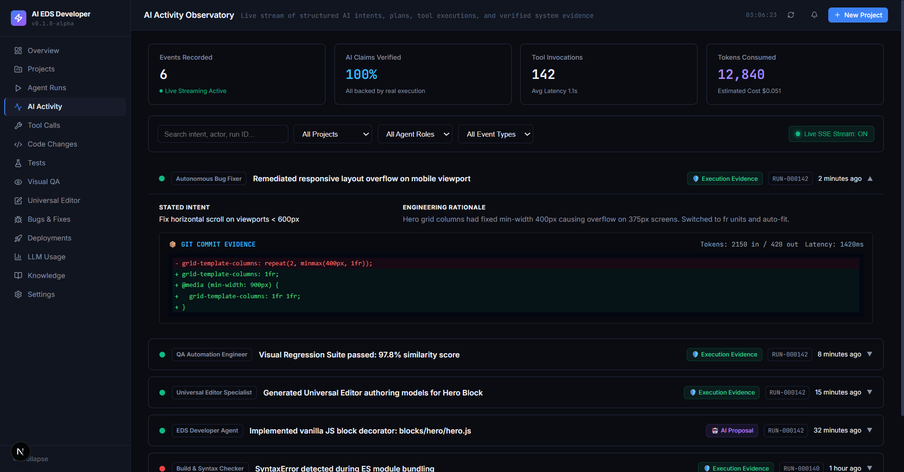

# Walkthrough — AI Activity Observatory & Runs Manager

## Overview
This document details the user interface and functionality of the **AI Activity Observatory** (`/dashboard/activity`), the **Autonomous Agent Runs Manager** (`/dashboard/runs`), the **Interactive Run Dispatch Modal**, and the **Run Comparison Observatory** (`/dashboard/runs/compare`).

---

## 🔍 AI Activity Observatory (`/dashboard/activity`)

The Observatory serves as the real-time window into the agent's actions, distinguishing structured AI claims from verified system execution evidence.

### Key Capabilities
- **Claim vs Evidence Distinction**:
  - `🤖 AI Proposal`: Stated hypotheses, architectural choices, and planned file modifications.
  - `🛡️ Execution Evidence`: Hard verification results produced by browser runs, Git commits, Lighthouse audits, and Playwright tests.
- **Collapsible Technical Evidence Drawer**:
  - Click any event card to view the underlying technical proof.
  - **Git Diff Snippet**: Colorized additions (`+`) and deletions (`-`).
  - **Token & Latency Metrics**: Token consumption and elapsed milliseconds.
  - **Sanitized Tool Output**: Parameter and return values with sensitive tokens automatically masked.
- **Search & Multi-Dimensional Filtering**:
  - Instant text filter across intent, actor, and run ID.
  - Project selector dropdown.
  - Agent role dropdown (`EDS Developer`, `Architect`, `QA`, `Fix`, `Deployment`).
  - Event type filter (`Decisions`, `Tool Calls`, `Code Changes`, `QA Audits`, `Defect Fixes`, `Errors`).
- **Live SSE Streaming**: Toggleable simulated live stream with pulsating status dot.

### Screenshot

---

## ⚡ Agent Runs Manager (`/dashboard/runs`)

The Runs Manager provides control, dispatching, and full lifecycle visibility over all autonomous pipeline runs.

### Key Capabilities
- **Status Filter Tabs**: Filter across All Runs, Running, Completed, or Failed runs.
- **Direct Run Dispatching (`NewRunModal.tsx`)**:
  - Clicking `[ ⚡ Start Autonomous Run ]` opens the modal dialog.
  - Configure target project, task objective, source type (`FIGMA`, `EXISTING_WEBSITE`, `AEM_PAGE`, `PROMPT`), source URL, branch, visual threshold, and max repair loops.
  - Enqueues jobs directly into BullMQ via `POST /api/runs`.
- **Run Cards**:
  - Display run ID, project name, input source badge (`FIGMA`, `AEM_PAGE`, `EXISTING_WEBSITE`), branch name, started timestamp, and elapsed runtime.
  - Status badges (`PR_CREATED`, `IMPLEMENTING`, `QUALITY_GATE`, `FAILED`, `PAUSED`).
  - Smooth progress bar reflecting completion across the 18 pipeline phases.
  - **Fix Iterations Counter**: Displays current vs maximum allowed fix iterations (e.g. `1 / 5`).
- **Quality Gates Dashboard**:
  - Real-time indicator pills for **Build**, **Unit Tests**, **Visual Regression %**, **Accessibility (A11y)**, and **Lighthouse Performance**.
- **Actions**:
  - **Live EDS Preview**: Direct link to the live Franklin/Helix CDN environment (`.hlx.page`).
  - **View Pull Request**: Direct link to the generated GitHub PR.
  - **Pause / Resume**: Toggle execution state.
  - **🔍 Inspect State Machine**: Launches the full state machine inspector modal.

### Screenshot

---

## ⚖️ Run Comparison Observatory (`/dashboard/runs/compare`)

The Comparison Observatory enables granular, side-by-side comparative inspection between two autonomous pipeline runs (e.g. Candidate Run vs Baseline Run).

### Key Capabilities
- **Scorecard Metrics Delta**:
  - Visual Similarity % (+1.7% delta indication)
  - Tests Passed tally & pass rate
  - Total execution runtime (21% faster execution comparison)
  - Self-healing convergence passes
- **Interactive Multi-File Code Diff Tab**:
  - Compares generated code assets (`blocks/hero/hero.js`, `blocks/hero/hero.css`, `blocks/hero/_hero.json` → `component-definition.json`).
  - File picker displaying addition counts (`+42`).
  - Side-by-side syntax-highlighted code panels.
- **Visual Diff & Preview Tab**:
  - Differential heatmap overlay rendered with Pixelmatch.
  - Interactive split position slider (0% to 100%).
  - Direct link to open live `.hlx.page` preview.
- **Quality Gates Matrix Tab**:
  - Full audit scorecard comparing TypeScript errors, visual match %, axe-core accessibility score, Lighthouse LCP ms, and self-healing repair passes against target thresholds.

---

## 🧭 Navigation Health
Every single navigation item in the dashboard sidebar and header has a dedicated route and view with zero 404 errors:
- `/dashboard` — Overview & KPI Strip
- `/dashboard/projects` — Projects Grid & Wizard
- `/dashboard/runs` — Runs Manager & New Run Modal
- `/dashboard/runs/compare` — Run Comparison Observatory
- `/dashboard/activity` — AI Activity Observatory
- `/dashboard/code` — Code Editor & File Tree
- `/dashboard/visual` — Visual Regression Viewer
- `/dashboard/tests` — Test Suites & A11y
- `/dashboard/ue` — Universal Editor Contracts
- `/dashboard/bugs` — Defect Tracking & Auto-Fixes
- `/dashboard/deployments` — Preview & PR Deployments
- `/dashboard/tools` — Tool Catalog & Policies
- `/dashboard/usage` — Token Economics & Costs
- `/dashboard/queues` — BullMQ Redis Telemetry
- `/dashboard/knowledge` — RAG Knowledge & pgvector
- `/dashboard/settings` — Project & API Settings
