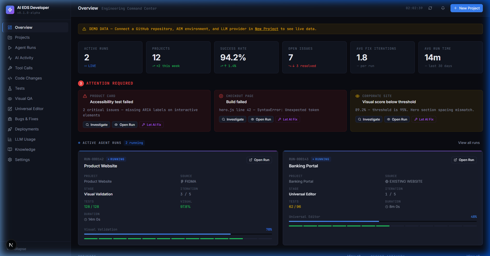
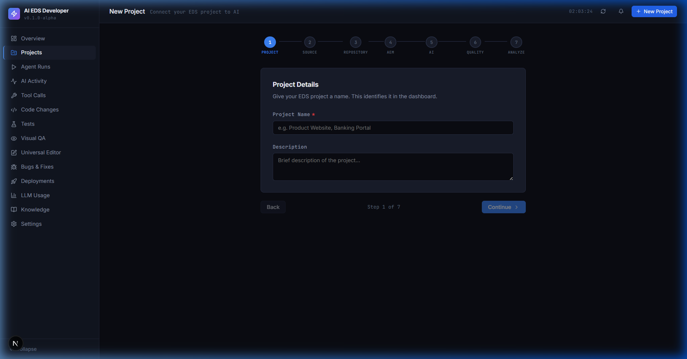
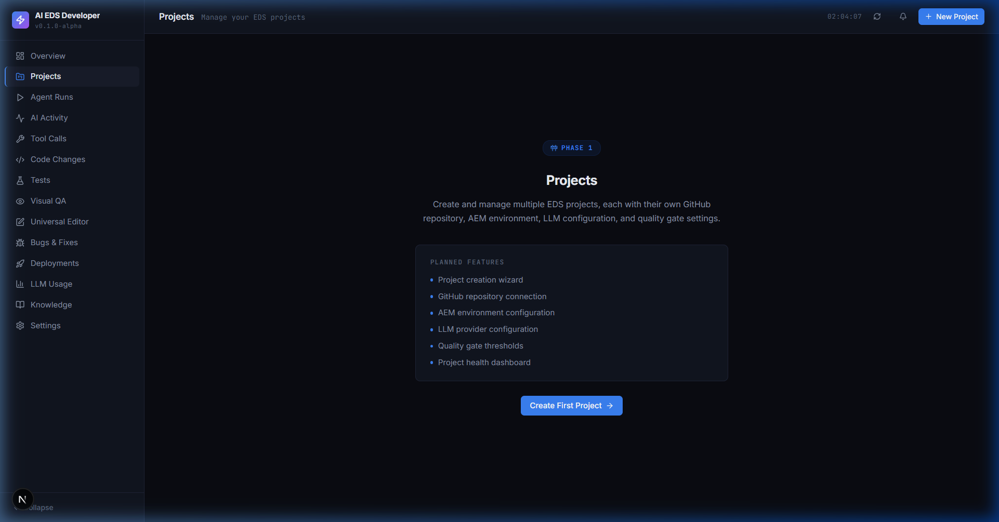

# Phase 0 & 1 — Foundation, Monorepo & Dashboard UI

## Overview
Phase 0 established the infrastructure, monorepo tooling, Docker stack, shared type contracts, and 25-table database schema. Phase 1 delivered the Next.js 15 App Router dashboard, responsive layout, KPI metrics strip, Attention Required alerts, and 7-step New Project wizard.

---

## 🛠️ Components Implemented

### 1. Monorepo & Workspaces
- Configured **Turborepo** (`turbo.json`) and **npm workspaces** managing 12 packages and apps.
- Enforced strict TypeScript typing (`tsconfig.json`) with ES2022 and NodeNext module resolution.
- Standardized package build pipelines using `tsup` targeting dual ESM and CJS formats with TypeScript `.d.ts` declaration generation.

### 2. Docker & Database Infrastructure
- Docker Compose services defined in `docker-compose.yml`:
  - **PostgreSQL 16 + pgvector**: Vector database for RAG document retrieval and embeddings.
  - **Redis 7**: High-speed cache and BullMQ job queue backend.
  - **MinIO**: S3-compatible local object storage for test screenshots and visual diff artifacts.
- **Drizzle ORM Schema** (`packages/database/src/schema/index.ts`):
  - 25 strongly typed tables covering users, projects, repositories, environments, agent runs, agent steps, agent events, tool calls, LLM calls, design sources, design artifacts, blocks, file changes, builds, test runs, visual runs, visual differences, accessibility runs, performance runs, bugs, fix attempts, pull requests, deployments, knowledge documents, and knowledge chunks.

### 3. Dashboard UI & Design System (`apps/web`)
- Built with **Next.js 15 (App Router)** and styled with **Tailwind CSS v4**.
- **Dark Theme Aesthetics**: Deep dark background (`#0f1117`), structured cards (`#1a1d27`), subtle borders (`#2a2d3a`), and curated semantic accents (Green: Success, Blue: Active, Purple: AI, Red: Critical).
- **Core Views**:
  - **KPI Strip**: 6 metric cards (Active Runs, Total Projects, Success Rate, Open Issues, Avg Fix Iterations, Avg Run Time).
  - **Attention Required Section**: Highlights failed builds, visual score degradations, or accessibility violations.
  - **Active Agent Runs**: Animated cards with progress bars and live status pills.
  - **Projects Grid**: Quick health overview across managed EDS repositories.
  - **New Project Wizard (7 Steps)**:
    1. Basics (Project Name, Description)
    2. Input Source (Figma, Website, AEM Page, Screenshot)
    3. GitHub Repository (Owner/Repo, Branch, Encrypted Token)
    4. AEM Configuration (Author URL, Program ID, Environment ID)
    5. Quality Gates (Visual threshold, Lighthouse budget, A11y rules)
    6. LLM Provider (OpenAI, Anthropic, Gemini, Ollama)
    7. Review & Launch

---

## 📸 Verified Screenshots

### Live Dashboard Overview

### New Project Wizard — Step 1

### Projects Health Grid

