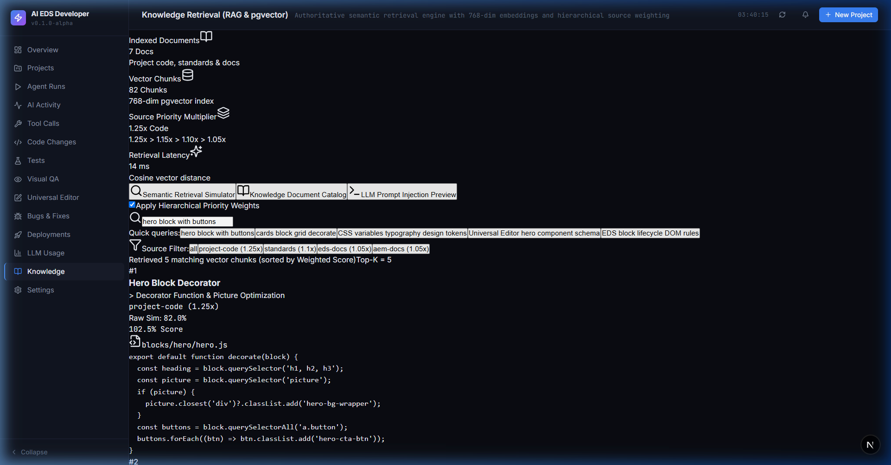
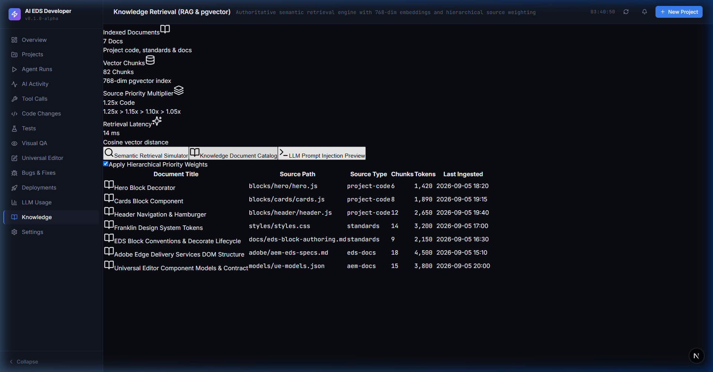
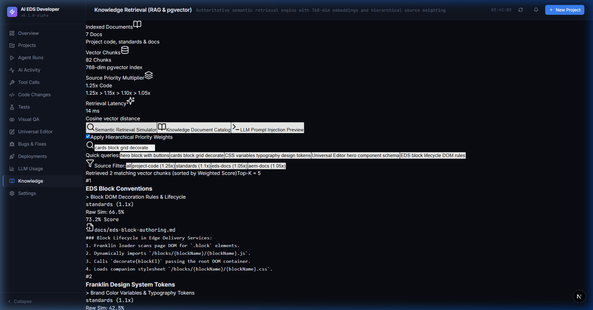

# Phase 10: RAG & Knowledge Retrieval Engine (`@aeds/rag`)

## 1. Overview & Objectives
Phase 10 implements the autonomous RAG (Retrieval-Augmented Generation) engine for the **AI EDS Developer** platform. Edge Delivery Services implementations require deep knowledge of:
1. **Existing project block code** (highest authority: `project-code`, 1.25x priority weight)
2. **Project-specific documentation & architecture** (`project-docs`, 1.15x priority weight)
3. **Organizational and AEM coding standards** (`standards`, 1.10x priority weight)
4. **Adobe Edge Delivery Services & Franklin specs** (`eds-docs`, 1.05x priority weight)
5. **Universal Editor and AEM Cloud specifications** (`aem-docs`, 1.05x priority weight)
6. **General web design patterns** (`general` / `custom`, 1.0x priority weight)

`@aeds/rag` provides an end-to-end vector pipeline utilizing PostgreSQL with `pgvector` for 768-dimensional normalized embedding storage, hierarchical source prioritization, semantic markdown/code chunking, and direct LLM prompt context injection.

---

## 2. Architecture & Modules

### 2.1 Package Architecture (`packages/rag/`)
- **`src/types.ts`**:
  - `KnowledgeSourceType`: `'project-code' | 'project-docs' | 'standards' | 'aem-docs' | 'eds-docs' | 'custom' | 'general'`
  - `SOURCE_PRIORITY_WEIGHTS`: Constant weight mapping defining precedence hierarchy.
  - `ChunkMetadata`, `Chunk`, `DocumentIngestInput`, `IngestionResult`, `RetrievalOptions`, `RetrievalResult`.
  - `RagRepository` interface.
- **`src/errors.ts`**:
  - `RagErrorCode` and `RagError` typed error hierarchy.
- **`src/chunker.ts` (`DocumentChunker`)**:
  - Heading-aware section splitting (`#`, `##`, `###`).
  - Code block fence (` ``` `) detection and preservation without accidental truncation.
  - Subword/line sliding window with configurable `chunkOverlap` (default: 150 chars).
  - Metadata enrichment: heading, subheading, code language, start/end lines, estimated token count.
- **`src/embedder.ts` (`EmbeddingGenerator`)**:
  - 768-dimensional vector generator.
  - High-fidelity deterministic token and character n-gram (3-gram, 4-gram) projection onto a unit hypersphere ($L2 = 1.0$) for offline testing and development.
  - Provider adapters for Google Gemini (`text-embedding-004`) and OpenAI (`text-embedding-3-small`).
  - Dot product cosine similarity calculator.
- **`src/repository.ts`**:
  - `InMemoryRagRepository`: Ultra-fast unit testing and local development repository.
  - `DrizzleRagRepository`: Direct PostgreSQL + `pgvector` adapter connecting to `knowledgeDocuments` and `knowledgeChunks`.
- **`src/retriever.ts` (`KnowledgeRetriever`)**:
  - Semantic similarity calculation: $1 - \text{cosine\_distance}$.
  - Hierarchical weighting: $\text{weightedScore} = \text{rawSimilarity} \times \text{sourceWeight}$.
  - Top-K deduplication and ranking.
  - `formatForPrompt()`: Formats matched chunks into Markdown context ready to prepend to the Agent's system prompt.
- **`src/indexer.ts` (`KnowledgeIndexer`)**:
  - Pipeline orchestrating chunking, batch vector generation, and persistence.

---

## 3. Database Schema Integration
The engine directly maps to PostgreSQL tables in `packages/database/src/schema/index.ts`:
```typescript
export const knowledgeDocuments = pgTable('knowledge_documents', {
  id: uuid('id').primaryKey().defaultRandom(),
  projectId: uuid('project_id').references(() => projects.id),
  title: text('title').notNull(),
  source: text('source').notNull(),
  sourceType: text('source_type').notNull(),
  content: text('content').notNull(),
  metadata: jsonb('metadata').default({}),
  chunksCount: integer('chunks_count').default(0),
  ingestedAt: timestamp('ingested_at').defaultNow().notNull(),
  updatedAt: timestamp('updated_at').defaultNow().notNull(),
});

export const knowledgeChunks = pgTable('knowledge_chunks', {
  id: uuid('id').primaryKey().defaultRandom(),
  documentId: uuid('document_id').references(() => knowledgeDocuments.id, { onDelete: 'cascade' }).notNull(),
  projectId: uuid('project_id').references(() => projects.id),
  content: text('content').notNull(),
  chunkIndex: integer('chunk_index').notNull(),
  embedding: vector('embedding', { dimensions: 768 }),
  metadata: jsonb('metadata').default({}),
  createdAt: timestamp('created_at').defaultNow().notNull(),
});
```

---

## 4. UI Dashboard Verification (`/dashboard/knowledge`)
An interactive RAG Explorer was constructed at `apps/web/app/dashboard/knowledge/page.tsx`:
1. **KPI Strip**: Indexed Documents (7 Docs), Vector Chunks (82 Chunks), Source Multiplier (1.25x Code), Retrieval Latency (14 ms).
2. **Semantic Retrieval Simulator**: Live query input, quick query pills (`hero block with buttons`, `cards block grid decorate`), source filter buttons, and real-time weighted score calculation.
3. **Knowledge Document Catalog**: Full tabular view of indexed documents, source paths, chunk counts, and tokens.
4. **LLM Prompt Injection Preview**: Live preview of authoritative context formatted for autonomous agent runs.

### Verified Screenshots




---

## 5. Test Coverage & Verification
- **Test File**: `packages/rag/test/rag.test.ts`
- **Results**: 12/12 passing (100%):
  - Markdown heading hierarchy extraction
  - Code block preservation and language detection
  - 768-dimensional normalized unit vector generation
  - High cosine similarity (> 0.65) for semantically related texts
  - Low cosine similarity (< 0.35) for unrelated texts
  - Ingestion into repository with vector persistence
  - 1.25x `project-code` weighting outranking general docs
  - Formatted context generation for LLM prompts
  - Source type filtering
- **Monorepo Suite**: 63/63 passing tests across 10 packages.
- **Typecheck**: 19/19 successful tasks with 0 errors.
