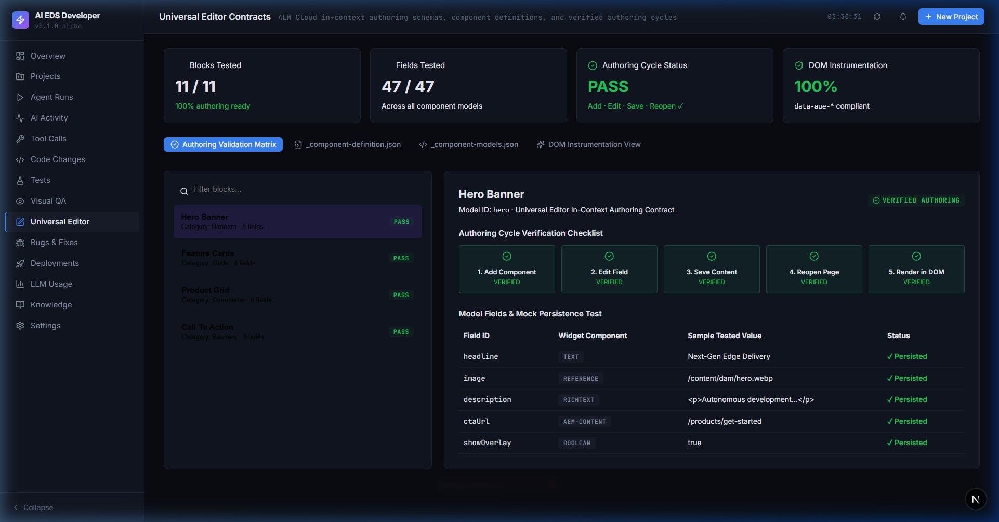

# Phase 8 — AEM Cloud & Universal Editor Adapter

## Overview
Phase 8 implemented `@aeds/aem`, the Adobe Experience Manager (AEM) Cloud and Universal Editor (UE) integration engine. It enables autonomous AI agents to validate in-context authoring contracts, generate schema definition catalogs, verify live DOM instrumentation attributes (`data-aue-*`), and execute authenticated AEM preview and publish pipelines.

---

## 🛠️ Components Implemented

### 1. AEM Cloud Client (`src/client.ts`)
- **`AemCloudClient`**: Authenticated HTTP client communicating with AEM as a Cloud Service:
  - `previewPage(path)`: Dispatches preview pipeline requests.
  - `publishPage(path)`: Replicates content to production environments via `/bin/replicate.json`.
  - `getContentFragment(path)`: Extracts structured Content Fragment models and element values via Assets HTTP API.
  - **Fails Loudly per §75**: Requires valid IMS Service Credentials or Bearer Token; rejects missing credentials with typed `AemError` (`AUTHENTICATION_REQUIRED`).

### 2. Universal Editor Model Generator (`src/models.ts`)
- **`UniversalEditorModelGenerator`**: Generates Adobe-standard configuration files:
  - **`_component-definition.json`**: Component catalog specifying component ID, display title, category, and authoring UI plugins.
  - **`_component-models.json`**: Field schemas supporting text, rich text, image references, links (`aem-content`), select dropdowns, booleans, and numbers.
  - **`_component-filters.json`**: Container-level placement and nesting rules.
  - **Smart Type Inference**: Automatically infers field types based on EDS block naming conventions (e.g. `icon`/`photo` → `reference`, `ctaUrl` → `aem-content`, `description` → `richtext`).

### 3. DOM Instrumentation Validator (`src/validator.ts`)
- **`UniversalEditorValidator`**: Audits rendered EDS block HTML for required Universal Editor data attributes:
  - Container-level: `data-aue-resource`, `data-aue-type="component"`, `data-aue-model`.
  - Field-level: `data-aue-prop`, `data-aue-type`.
  - Emits structured `InstrumentationCheck` identifying missing attributes.

### 4. Authoring Cycle Tester (`src/tester.ts`)
- **`UniversalEditorTester`**: Tests the complete authoring loop:
  - Step 1: Add component to page container.
  - Step 2: Edit field values.
  - Step 3: Save content.
  - Step 4: Reopen page and verify persisted values.
  - Step 5: Verify rendered DOM updates match authored values.
  - Produces an aggregated `AuthoringValidationReport`.

---

## 📸 Verified UI View: Universal Editor Dashboard (`/dashboard/ue`)

The Universal Editor Dashboard provides real-time authoring audit visibility, component model inspectors, and DOM instrumentation compliance:

---

## 🧪 Unit Tests (`packages/aem/test/aem.test.ts`)

10 passing tests validating:
1. **Authentication Guard**: Throws `AUTHENTICATION_REQUIRED` when credentials are not configured.
2. **Author URL Validation**: Validates presence of valid AEM author URL.
3. **Smart Field Type Inference**: Tests mapping of names to `reference`, `richtext`, `aem-content`, `boolean`, `number`, and `text`.
4. **Component Definitions Generation**: Validates Adobe schema conformance.
5. **Component Models Generation**: Validates field models and widget components.
6. **Component Filters Generation**: Validates container component allowlists.
7. **Schema Structure Validation**: Validates definitions and model constraints.
8. **DOM Instrumentation Auditing**: Confirms detection of valid `data-aue-*` tags and flags missing attributes.
9. **Authoring Cycle Verification**: Tests 5-step add-edit-save-reopen-render flow.
10. **Persistence Failure Detection**: Asserts that persistence mismatches trigger actionable errors for `FixAgent`.
